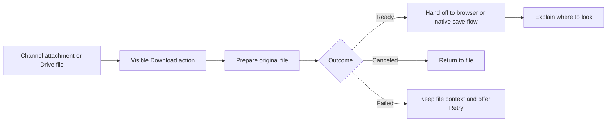
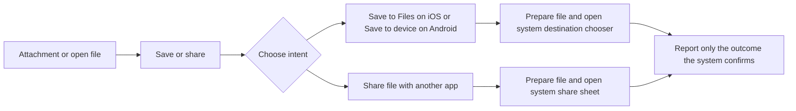

# Make downloads easy to find and understand

Status: proposal, 23 October 2026. Covers desktop web, the Mac app, iOS, and Android.

Put a labeled **Download** action beside the file people are looking at. On phones,
use **Save or share…** and explain the destination. Show the file name and type,
then distinguish preparation, handoff, and confirmed saving.

## Artifacts

- [Interactive concept](index.html): switch between Channel and Drive, compare
  current and proposed layouts, and try desktop, iOS, and Android outcomes. All
  files and transfers in the concept are illustrative.
- [Interaction and delivery specification](interaction-spec.md): placement,
  exact copy, platform behavior, implementation slices, and acceptance criteria.

Review copies in Macro: [journey map](https://macro.com/app/md/01a16974-f25b-78dd-bc61-1155b2a817a4)
and [interaction specification](https://macro.com/app/md/01a16974-87d4-7304-8c11-96b0e4d439df).

Preview screenshots: [Channel](assets/channel-preview.png),
[Drive](assets/drive-preview.png), and [mobile save and share](assets/mobile-preview.png).

The concept uses Macro's dark split workspace, narrow navigation rails, file
headers, channel messages, composer, and existing Phosphor icons. Its visual
reference is the supplied Macro screenshot and the app's `index.css`, sidebar,
split-header, channel-header, and Drive-header code. Prototype controls sit outside
the app at the bottom; **Next state** advances a simulated transfer. Mobile saving
and sharing sheets are proposed flows, not verified native implementations.

`concept.css` and `concept.js` accompany the HTML. The bundled Inter Latin font
comes from the existing `@fontsource-variable/inter` dependency; its license is in
`assets/Inter-LICENSE.txt`. Icon symbols come from the app's existing Phosphor
dependency (license in `assets/Phosphor-LICENSE.txt`) and Macro logo. The sample
screen recording is rendered as HTML.

## What prompted this

In the [15 October channel thread](https://macro.com/app/channel/0195d2dd-5de9-71f2-9d59-5d9734f1adb7?channel_message_id=01a14017-c430-7555-9fbb-dde07b2d25b7),
Valentina reported that she could not download Austin's video to her Mac. Austin
said the video was shared in a channel with no discoverable download menu. He also
reported that Chait had asked how to download from Drive.

This is direct evidence of two discoverability problems, not a measured failure
rate. Whether a file transfer itself failed in that incident is unknown.

## What the current code establishes

Inspected at commit `60bafd9e4619984750407d24feee9893443c4514`. These observations
describe the checkout, not a reproduction in the shipped clients.

| Surface | Observed behavior | Implication |
| --- | --- | --- |
| Channel video tile | Open viewer, Play inline, and expand actions; no Macro Download action | Saving relies on discovering another surface or platform player behavior |
| Channel video viewer | Native video playback, navigation, and close controls; no Macro Download action | Expanding the video does not reveal a consistent way to save it |
| Channel image viewer | The shared lightbox already exposes Download image | Image and video actions differ |
| Drive video detail | Registers Download in the breadcrumb file menu | The operation exists but is behind a menu beside the title |
| Standalone video block | Registers Download as a file operation; Share is a toolbar tool | Moving between surfaces changes what is immediately visible |
| Shared saving helper | Android uses a native save flow; other platforms dispatch an anchor download and return `saved: true` | A non-Android success value proves dispatch, not that a file reached disk |
| Channel media model | Has IDs, URLs, kind, and dimensions; no original filename, MIME type, or byte size | Rich file labels need metadata plumbing; do not invent a filename or size |

Sources: [channel grid](../../../apps/web/src/features/channel/Media/MediaGrid.tsx),
[media viewer](../../../apps/web/src/features/channel/Media/MediaViewerDialog.tsx),
[image lightbox](../../../apps/web/src/lib/core/component/Lightbox/Lightbox.tsx),
[Drive video](../../../apps/web/src/features/drive-view/views/VideoDetail.tsx),
[breadcrumb menu](../../../apps/web/src/features/drive-view/views/FileDetailBreadcrumbItem.tsx),
[video toolbar](../../../apps/web/src/features/block-video/component/TopBar.tsx),
[save helper](../../../apps/web/src/lib/filesystem/download.ts), and
[media model](../../../apps/web/src/features/channel/Media/media-items.ts).

## Journey map

| Moment | User's question | Current friction | Proposed experience | Evidence of success |
| --- | --- | --- | --- | --- |
| See a shared video | Can I take this with me? | Playback dominates; no labeled save action | Persistent Download beside the filename; Save or share… on phones | User finds the action without opening an overflow menu |
| Inspect the file | What am I getting? | Media may lack a readable filename or type | Original filename, type, size when known; original file by default | User can name the file and distinguish it from a Macro link |
| Start | Did my click work? | Surface-dependent feedback | Immediate Preparing filename…; ignore duplicate clicks while active | One operation starts and the control shows its state |
| Wait | Is it stuck? | Large files have uneven feedback across surfaces | Real byte progress when available; otherwise indeterminate preparation | User can wait or cancel without losing the conversation |
| Save or hand off | Where did it go? | A success toast can overstate what the app knows | Browser: Download started; native: confirmed Saved only when reported | User knows which browser control or system destination to check |
| Recover | How do I try again? | Generic errors can leave the next step unclear | Keep the filename visible, explain failure, offer Retry | Retry starts one fresh operation; cancellation stays neutral |

### Desktop journey

### Mobile journey

The mobile chooser is a proposed product contract. Android already has save/share
adapters. iOS file export and share capabilities need verification before selecting
an implementation or promising those controls in a release.

## Placement decisions

1. **Channel message:** put a compact, always visible action strip below media.
   For one video it shows the filename and Download. On touch it shows Save or
   share…. For a gallery, expose an action per focused item in the viewer; do not
   make one ambiguous button download every attachment.
2. **Expanded media:** keep the same labeled action visible beside Close, outside
   the video player's controls. It applies to the current item.
3. **Drive:** put Download in the open file's header beside Share. A selected file
   also gets a labeled action in the selection toolbar, so users can save without
   opening it. Keep the menu item as an additional route. Multiple selections and
   folders need separate eligibility and packaging work.
4. **Mobile:** keep Save or share… visible without hover. The sheet offers local
   saving and sharing the actual file. Macro access sharing stays a separate action.

## Vocabulary

| Intent | Label | Meaning |
| --- | --- | --- |
| Get an existing file on desktop | Download | Save a copy of the original file on this device |
| Choose a phone destination | Save or share… | Choose local saving or sending the file to another app |
| Send bytes to another app | Share file… | Share an attachment, not a Macro URL |
| Give someone Macro access | Share in Macro / Copy Macro link | Existing permissions and link flow; does not save a file |
| Convert an editable document | Download as… | Pick from formats actually supported for that document |

For a video, no format picker is needed. For editable documents, expose supported
formats with plain explanations (for example, “PDF — a copy for reading”). Do not
present PDF, DOCX, or another format until that document's exporter supports it.

## Priorities

**First release:** visible channel video and open-file Drive actions, keyboard and
touch access, meaningful filenames where available, truthful state messages,
failure recovery, and Android save/share routing. Verify iOS export before releasing
the corresponding action.

**Next:** selected-file Drive action, consistent image/file actions, and explicit
format choices for supported editable documents.

**Later, only if research supports it:** bulk downloads, folder ZIPs, and persistent
download history. These do not need to block the reported single-video problem.

## Evaluate the proposal

Use five people who do not know the download implementation, including desktop and
mobile users. Give them the task, not the control name: “Keep this channel video
on your device so you can use it outside Macro.” Then repeat with a Drive file.

Proposed decision criteria: at least four of five locate the action unaided within
ten seconds; all can explain whether they saved a file or shared a Macro link;
and no one interprets canceled or failed saving as success. Also ask them to find
the saved file. These are research targets, not results.

Measure discovery separately from delivery: action impressions and starts answer
whether people find it; preparation failures and platform outcomes answer whether
it works. Browser handoff is not a completed-save metric.
